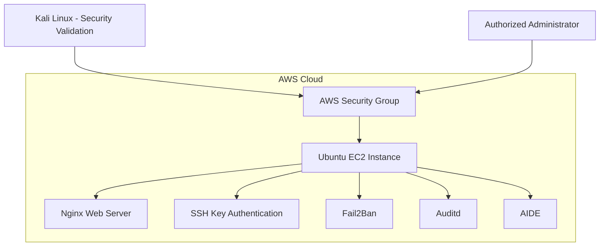

# AWS Cloud Security Hardening

## Securing a Public Cloud Server: An AWS EC2 Case Study

## Project Overview

This project demonstrates the implementation of a defense-in-depth security architecture for a cloud-hosted Linux server on Amazon Web Services (AWS).

The main objective is to identify security weaknesses, reduce the attack surface, strengthen authentication, monitor security events, and verify system integrity.

## Project Objectives

- Deploy a cloud-based Linux server on AWS.
- Configure secure cloud networking.
- Identify exposed network services.
- Reduce the external attack surface.
- Implement SSH key-based authentication.
- Monitor unauthorized authentication attempts.
- Implement system auditing and file integrity monitoring.
- Evaluate security controls before and after hardening.

## Technologies and Tools

| Technology | Purpose |
|---|---|
| Amazon EC2 | Cloud computing infrastructure |
| Amazon VPC | Virtual network isolation |
| AWS Security Groups | Network access control |
| Ubuntu Linux | Server operating system |
| Nginx | Web server |
| OpenSSH | Secure remote administration |
| Nmap | Network security assessment |
| Fail2Ban | Authentication monitoring and intrusion prevention |
| Auditd | Linux security auditing |
| AIDE | File integrity monitoring |
| Kali Linux | Security validation environment |
| AWS CLI | Cloud infrastructure management |

## Architecture

## Implemented Security Controls

### Network Security

AWS Security Groups were used to restrict inbound traffic and reduce unnecessary network exposure.

### Authentication Security

SSH key-based authentication was implemented, with password authentication disabled.

### Intrusion Prevention

Fail2Ban was configured to monitor SSH authentication failures and support automated blocking.

### Security Auditing

Auditd was configured to monitor sensitive system files and security-related modifications.

### File Integrity Monitoring

AIDE was implemented to detect filesystem changes by comparing the current system state against an integrity baseline.

## Security Assessment Results

| Security Control | Before Hardening | After Hardening |
|---|---|---|
| Network exposure | SSH and HTTP reachable | Tested ports filtered from external test source |
| SSH authentication | Initial configuration | Key-based authentication |
| Authentication monitoring | Not established | Fail2Ban active |
| System auditing | Not established | Auditd rules loaded |
| File integrity monitoring | Not established | AIDE baseline and checks |

Historical testing showed reduced network exposure, rejected unauthorized SSH authentication, and detection of filesystem changes.

## Repository Structure

- architecture/ - Architecture diagrams
- infrastructure/ - AWS infrastructure documentation
- hardening/ - Security configuration documentation
- validation/ - Security assessment results
- screenshots/ - Supporting evidence
- documentation/ - Project report and security controls

## Security Principles

- Defense in depth
- Least privilege
- Attack surface reduction
- Network segmentation
- Secure authentication
- Security monitoring
- File integrity verification

## Project Status

This repository reconstructs a previously implemented academic cloud security project. Historical results are documented from previous project records. Original screenshots and exact configuration files are not currently available.

## Conclusion

This project demonstrates how multiple complementary security controls can improve the security posture of a cloud-hosted Linux server.

All security assessments were conducted within an authorized academic environment.
