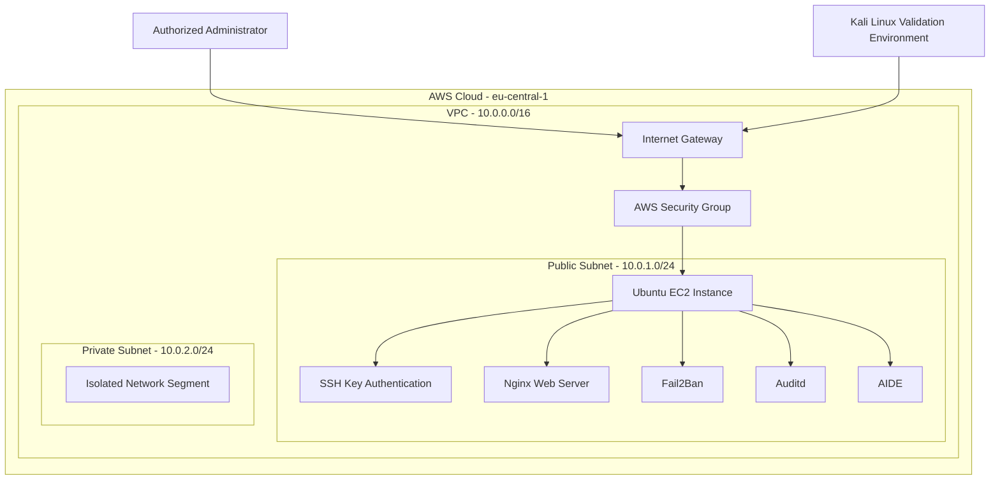

# Cloud Security Architecture

## Defense-in-Depth Architecture

## Security Layers

1. Network isolation using Amazon VPC.
2. Network access control using AWS Security Groups.
3. Secure authentication using SSH keys.
4. Authentication monitoring using Fail2Ban.
5. System auditing using Auditd.
6. File integrity monitoring using AIDE.

## Architecture Status

This diagram represents the reconstructed historical project architecture.
It is not a live AWS infrastructure inventory.
